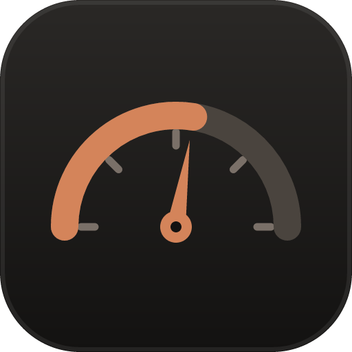

# TokenGauge



[](https://github.com/Martinnezsavemaiwai/TokenGauge/actions/workflows/ci.yml)

> Windows Taskbar Companion for AI Coding Assistants. Your AI coding usage, always one glance away.

TokenGauge is a native-feeling Windows 11 system tray companion that keeps your AI coding usage visible from the taskbar — no settings page, no web dashboard. It reads the limits your assistant actually enforces and shows how much of them you have spent.

TokenGauge is the instrument; the assistant is what it is pointed at. Claude Code is the provider that ships today, Codex is next, and the frame is built to swap.

## Features

- **Three distances, three jobs**: the tray icon carries state, the hover popup answers "how much is left" in about two seconds, and the click flyout is the full dashboard.
- **Real plan limits**: session (5 hr) and weekly (all models) windows straight from Anthropic's usage API, with the weekly Opus window on plans that meter it separately. Each has its own reset clock and its own severity color.
- **Plan awareness**: your subscription tier (Pro, Max, …) is read from the local Claude Code credentials and shown in the panel.
- **Provider selector**: the dashboard names what it is measuring. Adding a provider is a row in `src/providers/registry.ts`, not a redesign.
- **Honest degradation**: when the OAuth token expires or the network drops, TokenGauge keeps the last good numbers and says *sync paused* — it never silently falls back to a made-up percentage.
- **Smart notifications**: native Windows toasts at 60 / 80 / 90 / 100% of each metered window. Each threshold fires once per limit period — the marks are keyed to the window's reset time and persisted, so relaunching TokenGauge does not re-announce what you already saw — and exactly one tray window owns them so you never get doubles. Only one copy of TokenGauge can run at a time, so a second launch cannot double them either.
- **Rolling 24-hour trend**: a sparkline over the same rolling 24 hours the limits use, cropped to the stretch you were actually active in. The axis prints the real clock hours of that stretch, so a quiet night does not render as dead air.
- **System-first theming**: follows the Windows light/dark setting by default, with manual override, plus English and Thai.

## Interface

| Surface | Trigger | Shows |
| --- | --- | --- |
| Tray icon | always visible | usage state via icon color |
| Hover popup | hover the tray icon | ring, headline percentage, session reset, weekly meter |
| Dashboard | click the tray icon | Overview · Models · History · Settings |

Flyouts are positioned against the monitor the tray icon is on and clamped to its work area, so they behave on multi-monitor desktops with different scaling per screen.

`Models` and `History` are present in this release as designed empty states; their data layer (per-model tokens and daily history, read from the local session files) lands next.

## Installation

Download the latest installer from the [Releases](https://github.com/Martinnezsavemaiwai/TokenGauge/releases) page, or build from source below.

> The installer isn't code-signed yet, so Windows SmartScreen may warn on first run ("Windows protected your PC" → More info → Run anyway).

### Build from source

### Prerequisites
- Node.js (v18+)
- Rust (v1.75+)
- Visual Studio Build Tools (for Windows)

### Build Instructions

1. Clone the repository:
   ```bash
   git clone https://github.com/Martinnezsavemaiwai/TokenGauge.git
   cd TokenGauge
   ```

2. Install dependencies:
   ```bash
   npm install
   ```

3. Run in development mode:
   ```bash
   npm run tauri dev
   ```

4. Build for production:
   ```bash
   npm run tauri build
   ```

## Development

TokenGauge comes with a built-in "Dev Mode" layout that lets you manually simulate usage thresholds (0% to 100%) to see how the UI reacts. Run `npm run dev` to see the web UI, or `npm run tauri dev` to test the full Windows tray integration. `npm test` runs the unit tests.

## Architecture

TokenGauge follows a strict **Provider-based Architecture**. The React frontend is fully decoupled from the usage data sources: every provider implements `Provider` and returns a normalized `UsageSnapshot`, and the shell, thresholds, and notification engine never learn which one they are looking at.

```typescript
export interface Provider {
  id: string;
  name: string;
  icon: string;
  getUsage(): Promise<UsageSnapshot>;
}
```

A snapshot carries the metered windows it knows about, so a provider with different limits needs no UI change:

```typescript
interface UsageLimit {
  kind: "session" | "weekly" | "weekly_opus";
  percent: number;
  resetAt?: Date;
}
```

Register a provider in [`src/providers/registry.ts`](src/providers/registry.ts); planned ones are listed and disabled rather than hidden. Today that is Claude Code (live) and Codex (planned).

## Privacy

TokenGauge reads local files and talks to two hosts, both over HTTPS:

- `api.anthropic.com/api/oauth/usage` — your rate-limit windows, authenticated with the OAuth token Claude Code already stored in `~/.claude/.credentials.json`. The token is read at request time and used for nothing else; TokenGauge never writes that file, never logs the token, and never sends it anywhere else.
- `api.github.com` — unauthenticated release listing for "Check for Updates".

Your session files (`~/.claude/projects/**/*.jsonl`) are read locally for token counts and timestamps only. Nothing from them leaves the machine. There is no telemetry and no TokenGauge server.

## Contributing

See [CONTRIBUTING.md](CONTRIBUTING.md) for guidelines on how to add a new provider or submit pull requests.

## License

This project is licensed under the MIT License - see the [LICENSE](LICENSE) file for details.
